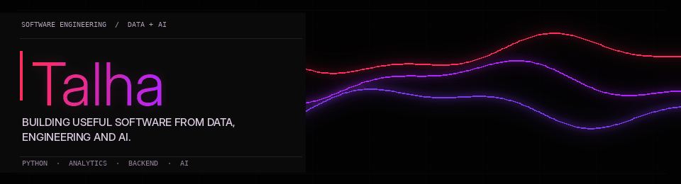
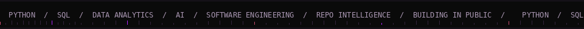
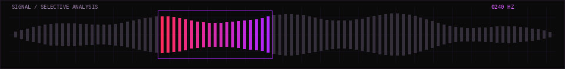

  

  
SOFTWARE ENGINEERING STUDENT&nbsp; · &nbsp;PYTHON&nbsp; · &nbsp;DATA ANALYTICS&nbsp; · &nbsp;BACKEND&nbsp; · &nbsp;AI

  
  

  

I'm a **BS Software Engineering student from Pakistan** focused on building practical applications across **Python, Data Analytics, Backend Development, and AI**.

I enjoy turning raw data into meaningful insights, building useful software around those insights, and learning the engineering required to move from an idea to a working product.

| Project | What it explores | Links |
|---|---|---|
| **RepoPulse** | A GitHub repository intelligence and analytics platform for exploring repository metadata, languages, activity, contributors, issues, releases and more. | [Repository](https://github.com/Talha-dotcom-hub/RepoPulse) |
| **DataLensLab** | An AI-assisted data analysis experience focused on making dataset workflows clearer and more useful. | [Live app](https://datalenslab.netlify.app/) |
| **E-Commerce Customer Retention** | An end-to-end RFM and customer-retention dashboard built with Python, Pandas, SQL and Streamlit. | [Repository](https://github.com/Talha-dotcom-hub/ecommerce-customer-retention) · [Live demo](https://talha-ecommerce-retention.streamlit.app/) |

  
  
  
  
  
  
  
  
  
  
  

- Data profiling and quality assessment
- Exploratory Data Analysis (EDA)
- Missing-value and duplicate detection
- Data validation and consistency checks
- Aggregation, filtering, ranking, and segmentation
- Trend and time-series analysis
- IQR-based outlier detection and correlation analysis
- Visualization and dashboard-oriented reporting
- Translating analytical results into clear business insights
- AI-assisted analytics workflows

I'm open to **learning opportunities, collaboration, interesting projects, software engineering, and data analytics**.

  
  

---

  BUILT WITH CURIOSITY, CODE, DATA, AND A LOT OF DEBUGGING.

