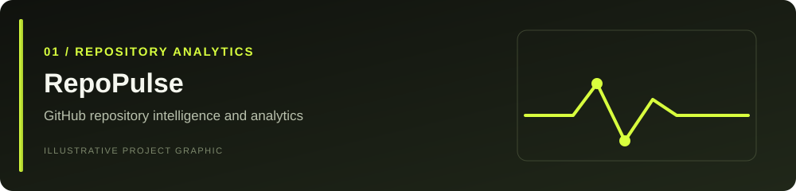
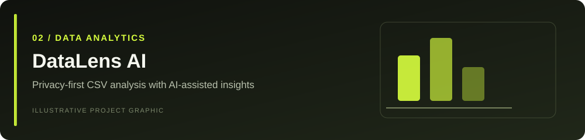
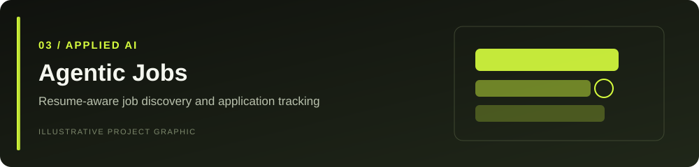
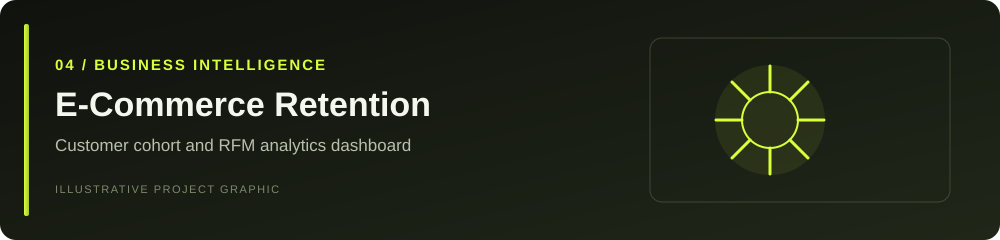

<!-- =========================================================
     M TALHA IFTIKHAR — GITHUB PROFILE README
     Visual direction: Dark editorial / Neon lime / Minimal
     No repository cards or project listings
========================================================== -->

 

 

&nbsp;

  

&nbsp;

---

## `01` - A little about me

### SOFTWARE ENGINEERING  /  DATA  /  AI

I'm **M Talha Iftikhar**, a Software Engineering student interested in turning data, code, and emerging AI capabilities into practical solutions.

I enjoy understanding problems, discovering patterns in data, and building applications that are useful, reliable, and thoughtfully designed.

<table>
<tr>
<td width="50%" valign="top">

**01 / AREAS I EXPLORE**

---

**DATA ANALYTICS**

Exploring datasets, validating data quality, and identifying meaningful patterns.

 

**PYTHON & PROBLEM SOLVING**

Using structured thinking and Python to investigate problems and build solutions.

 

**SOFTWARE DEVELOPMENT**

Developing application workflows, backend logic, and practical tools.

</td>
<td width="50%" valign="top">

**02 / HOW I WORK**

---

**ANALYTICAL THINKING**

Break problems into smaller questions and examine the evidence.

 

**PRACTICAL EXECUTION**

Focus on useful outcomes rather than unnecessary complexity.

 

**CONTINUOUS IMPROVEMENT**

Value readable code, thoughtful iteration, and learning by building.

</td>
</tr>
</table>

UNDERSTAND THE PROBLEM. BUILD WITH PURPOSE. KEEP IMPROVING.

---
## `02` — Technical toolkit

**LANGUAGES & DEVELOPMENT**

  

**DATA, DATABASES & PLATFORMS**

<b>Explore my areas of interest</b>

 

| Area | Focus |
|---|---|
| Python | Data processing, scripting, problem solving |
| Data analytics | Data cleaning, exploration, trends and insights |
| SQL | Querying, filtering, aggregation and relational data |
| Visualization | Communicating findings through charts and dashboards |
| Web development | Interfaces, application workflows and responsive design |
| Backend systems | APIs, data handling and application logic |
| AI | Exploring practical AI-assisted workflows |
| Developer tools | Git, GitHub, debugging and iterative improvement |

---

## `03` - Data & analytical thinking

<table>
<tr>
<td colspan="3" align="center" bgcolor="#151A12">

 

I turn raw data into structured analysis and actionable insights.

</td>
</tr>
<tr>
<td align="center" width="33%" valign="top" bgcolor="#111610">

  

### Understand the data

---

Identify the structure, completeness, quality, and limitations of a dataset before analysis.

 

DATA QUALITY / EDA

</td>
<td align="center" width="33%" valign="top" bgcolor="#151A12">

  

### Find the signal

---

Use filtering, aggregation, segmentation, and statistical exploration to uncover patterns.

 

TRENDS / PATTERNS

</td>
<td align="center" width="33%" valign="top" bgcolor="#111610">

  

### Deliver insights

---

Translate findings into clear explanations that help people make better-informed decisions.

 

REPORTING / DECISIONS

</td>
</tr>
</table>

 

### `//` Analytical toolkit

<table>
<tr>
<td width="50%" valign="top">

- Exploratory Data Analysis (EDA)
- Missing-value and duplicate detection
- Data quality and consistency checks
- Filtering, grouping, and aggregation

</td>
<td width="50%" valign="top">

- Trend and outlier detection
- Correlation analysis
- Segmentation and dashboard reporting
- AI-assisted analytical workflows

</td>
</tr>
</table>

01 — UNDERSTAND &nbsp; / &nbsp; 02 — INVESTIGATE &nbsp; / &nbsp; 03 — COMMUNICATE

---
## `04` — Current direction

  

I'm continuously strengthening my analytical skills, improving my software engineering foundations, and learning how to build reliable, useful applications.

---

## `05` — Featured projects

A small selection of projects that reflect my interests in repository analytics, practical AI, and data-driven applications.

**[RepoPulse](https://github.com/Talha-dotcom-hub/RepoPulse)**

A GitHub repository intelligence platform for exploring repository metadata, activity, commits, issues, pull requests, releases, and more.

**Technologies:** React, TypeScript, Vite, Tailwind CSS, GitHub REST API.

[Live Demo](https://repopulseai.netlify.app/) · [Source Code](https://github.com/Talha-dotcom-hub/RepoPulse)

 

**[DataLens AI](https://github.com/Talha-dotcom-hub/datalens-ai)**

A privacy-first CSV analytics application that performs data profiling and calculations in the browser, with Gemini-assisted query planning and explanations.

**Technologies:** React, TypeScript, Vite, browser-based data processing, Netlify Functions, Google Gemini.

[Live Demo](https://datalenslab.netlify.app/) · [Source Code](https://github.com/Talha-dotcom-hub/datalens-ai)

 

**[Agentic Jobs](https://github.com/Talha-dotcom-hub/Agentic-Jobs)**

A resume-aware job discovery workspace for matching opportunities to a candidate profile and organizing saved jobs and applications. Automated scans and notifications depend on backend and provider configuration.

**Technologies:** React, TypeScript, Vite, Node.js, Express, Supabase, PostgreSQL, Google Gemini.

[Live Demo](https://agenticjobs.netlify.app/) · [Source Code](https://github.com/Talha-dotcom-hub/Agentic-Jobs)

 

**[E-Commerce Customer Retention & RFM Analytics](https://github.com/Talha-dotcom-hub/ecommerce-customer-retention)**

An analytics dashboard for exploring customer cohorts, repeat-purchase behavior, retention patterns, and RFM-based customer segments using a synthetic retail dataset.

**Technologies:** Python, pandas, NumPy, SQL, DuckDB, SQLAlchemy, Streamlit, Plotly, pytest.

[Live Demo](https://talha-ecommerce-retention.streamlit.app/) · [Source Code](https://github.com/Talha-dotcom-hub/ecommerce-customer-retention)

---

## `06` — Let's connect

Interested in data analytics, Python, software engineering, or practical AI applications?

I'm open to connecting with people who enjoy learning, sharing ideas, and building useful things.

  

BUILD WITH PURPOSE. ANALYZE WITH CURIOSITY. KEEP ITERATING.

 

